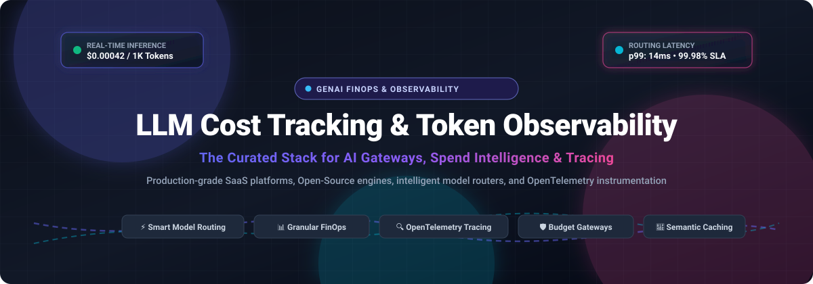

  

# 💸 Awesome LLM Cost Tracking & Token Observability 🔍

  
  
  
  
  

---

> **A curated showcase of top LLM cost tracking platforms, token observability suites, AI proxy gateways, intelligent model routers, GenAI FinOps spend dashboards, and OpenTelemetry tracing frameworks.**

Whether you are scaling agentic workflows, enforcing strict departmental budgets, or optimizing multi-provider inference costs, this collection categorizes leading **commercial SaaS solutions** alongside top-tier **open-source repositories** sorted by popularity.

---

## 📑 Table of Contents

- [🌐 Sector Overview & Market Dynamics](#-sector-overview--market-dynamics)
- [☁️ SaaS / Hosted Platforms](#️-saas--hosted-platforms)
- [🔓 Open-Source Equivalents & Tools (Sorted by Stars)](#-open-source-equivalents--tools-sorted-by-stars)
  - [🚪 AI Gateways, LLM Proxies & Budget Enforcement](#-ai-gateways-llm-proxies--budget-enforcement)
  - [📊 LLM Observability, Evaluation & Tracing Dashboards](#-llm-observability-evaluation--tracing-dashboards)
  - [🧠 Smart Model Routers, Compression & Caching](#-smart-model-routers-compression--caching)
  - [🧮 Token Usage Trackers & Cost Calculators](#-token-usage-trackers--cost-calculators)
  - [📡 OpenTelemetry GenAI Instrumentation](#-opentelemetry-genai-instrumentation)
- [📈 Star History](#-star-history)
- [💖 Support & Sponsorship](#-support--sponsorship)
- [🤝 Contributing](#-contributing)

---

## 🌐 Sector Overview & Market Dynamics

The dedicated **LLM Observability, AI Gateway, and GenAI FinOps** market is projected to expand from **$500M–$600M in 2024** to over **$1.7B–$3.3B by 2026**, growing at a rapid Compound Annual Growth Rate (CAGR) of **~32–36%** as enterprise generative AI deployments transition from experimental prototypes to multi-agent production systems.

Currently, the sector exhibits **moderate fragmentation with aggressive consolidation underway**: while dynamic, developer-first startups initially dominated specialized niches (such as semantic routing, prompt tracing, and token logging), incumbent cloud observability giants (e.g., Datadog, Cloudflare, Palo Alto Networks, ClickHouse) are actively acquiring point solutions or bundling end-to-end LLM control planes to establish unified, multi-modal APM dominance.

---

## ☁️ SaaS / Hosted Platforms

Below is an overview of commercial, cloud-hosted LLM observability platforms, AI gateways, and cost-tracking solutions. Entries are sorted descending by company scale (market capitalization / valuation / funding):

| Company / Product | Size / Valuation / Capitalization | Description | Starting Price Tier | Free Tier Limits |
| :--- | :--- | :--- | :--- | :--- |
| **[Cloudflare AI Gateway](https://cloudflare.com)** | **~$101B – $107B** Market Cap | Edge-native unified AI gateway offering token usage analytics, response caching, rate limiting, and DLP security scanning across models. | **$5/month** *(Cloudflare Workers Paid)* | **Free forever plan**: Up to 10 gateways, full analytics, caching, and rate limiting; 100,000 stored logs across all gateways. |
| **[Datadog LLM Observability](https://datadoghq.com)** | **~$57B** Market Cap | Enterprise full-stack AI and agent observability suite monitoring token consumption, operational latency, cost attribution, and drift alongside APM. | **$160/month** *(Pro plan on annual commitment; includes 100,000 LLM spans)* | **Free tier**: 40,000 billable LLM spans/month with 15-day trace retention and full platform feature access. |
| **[Martian](https://withmartian.com)** | **~$1.3B** Valuation | Model Intelligence routing platform dynamically analyzing prompts in real-time to dispatch each query to the most cost-effective foundation model. | **Usage-based routing**: ~$0.05 per million routed tokens + underlying provider cost | **No permanent free tier**: Direct API access invoiced based on token consumption; pilot testing available upon request. |
| **[Unify.ai](https://unify.ai)** | **~$260M** Valuation | Intelligent model router, benchmarking hub, and multi-model gateway optimizing speed, token cost, and quality across LLMs. | **$20/seat/month** *(Base tier with bundled monthly credits)* | **Free forever plan**: Includes starter workspace credits, access to model benchmarking, and up to 3 seats. |
| **[Portkey](https://portkey.ai)** | **~$120M – $140M** Valuation *(Acquired by Palo Alto Networks)* | Production AI gateway and control plane unifying 200+ LLMs with team budgets, semantic caching, fallback routing, and spend analytics. | **$49/month** *(Pro tier with scaling usage)* | **Developer free plan**: 10,000 requests/logs per month, access to unified gateway, caching, and analytics. |
| **[Helicone Cloud](https://helicone.ai)** | **~$25M** Valuation *(Acquired by Mintlify)* | Developer-friendly LLM observability proxy providing instant token cost tracking, user attribution, latency analytics, and caching via a 1-line integration. | **$79/month** *(Pro tier)* | **Hobby plan (Free)**: 10,000 requests per month, 1 GB storage, 7-day data retention, 1 seat, and 10 logs/min rate limit. |
| **[Langfuse Cloud](https://langfuse.com)** | **~$4.5M+** Raised *(Acquired by ClickHouse)* | Open-source-native hosted observability suite delivering granular token cost attribution, user/session analytics, and trace trees. | **$29/month** *(Core plan; includes 100,000 units/month and 90-day retention)* | **Hobby plan (Free)**: 50,000 units (traces/observations)/month, 30-day data retention, up to 2 team members, 1,000 req/min ingestion. |
| **[PromptLayer](https://promptlayer.com)** | **~$4.8M** Seed Funding | Prompt engineering, evaluation, and observability platform tracking request costs, token volumes, latency, and prompt release performance. | **$49/month** *(Pro tier; additional volume at ~$0.003/request)* | **Free plan**: 2,500 requests per month, prompt registry, and basic request logging. |
| **[LiteLLM Enterprise / BerriAI Cloud](https://litellm.ai)** | **~$6M+** ARR *(Seed backed by YC)* | Commercial support and enterprise control plane for LiteLLM with team SSO, virtual budget keys, RBAC, and chargeback dashboards. | **Custom annual pricing** *(Based on annual gateway capacity/RPS; self-hosted open core is $0)* | **30-day Free Trial**: Full Enterprise feature access upon request; open-source core has **unlimited requests/tokens** self-hosted. |
| **[Keywords AI](https://keywordsai.co)** | YC Backed | Cloud-hosted LLM gateway and observability platform featuring real-time token spend metrics, user budgets, and automated fallback routing. | **$199/month** *(Team tier billed annually)* | **Free tier**: 10,000 free requests per month, core unified gateway access, and basic monitoring. |

---

## 🔓 Open-Source Equivalents & Tools (Sorted by Stars)

Free and open-source software (FOSS) token trackers, self-hosted LLM observability platforms, AI proxy gateways, intelligent routers, and OpenTelemetry instrumentation libraries. Repositories in each section are sorted descending by GitHub Stars_Count.

### 🚪 AI Gateways, LLM Proxies & Budget Enforcement

* **[LiteLLM Proxy](https://github.com/BerriAI/litellm)**  - High-performance AI proxy server calling 100+ LLMs in OpenAI format while tracking spend, enforcing virtual key budgets, and load balancing.
* **[Kong AI Gateway](https://github.com/Kong/kong)**  - Cloud-native enterprise API gateway extended with AI plugins for token rate limiting, semantic caching, prompt governance, and cost analytics.
* **[One API](https://github.com/songquanpeng/one-api)**  - Comprehensive open-source LLM API management and distribution system with token quota accounting, billing, and multi-channel routing.
* **[Portkey AI Gateway](https://github.com/Portkey-AI/gateway)**  - Blazing-fast, lightweight open-source AI gateway written in TypeScript supporting multi-provider routing, fallbacks, retries, and token logging.
* **[TensorZero](https://github.com/tensorzero/tensorzero)**  - High-performance open-source gateway & learning flywheel written in Rust combining routing, observability, and automated model optimization.
* **[Bifrost (Maxim AI)](https://github.com/maximhq/bifrost)**  - Ultra-fast open-source LLM gateway written in Go delivering sub-millisecond overhead, semantic caching, budget caps, and multi-provider load balancing.

### 📊 LLM Observability, Evaluation & Tracing Dashboards

* **[Langfuse](https://github.com/langfuse/langfuse)**  - Leading open-source LLM engineering and observability platform with automated token cost calculation, user/session attribution, and trace trees.
* **[Opik (Comet)](https://github.com/comet-ml/opik)**  - Open-source LLM tracing, evaluation, and production monitoring platform engineered for high-volume trace ingestion and token analytics.
* **[Arize Phoenix](https://github.com/Arize-ai/phoenix)**  - Open-source, OpenTelemetry-native AI observability platform capturing token usage, latency, and agent trace spans locally or on Kubernetes.
* **[Helicone (Open Core)](https://github.com/Helicone/helicone)**  - Open-source LLM observability platform and proxy logging requests, token counts, latency, and USD cost with self-hosted Docker support.
* **[AgentOps](https://github.com/AgentOps-AI/agentops)**  - Open-source Python SDK for AI agents tracking recursive token spend, tool usage costs, latency, and step-by-step session replays.
* **[Deepchecks LLM Evaluation](https://github.com/deepchecks/deepchecks)**  - Open-source continuous validation and observability suite monitoring LLM costs, response quality, and pipeline performance.
* **[TruLens](https://github.com/truera/trulens)**  - Evaluation and tracking framework for LLM applications providing instrumentation, feedback functions, token usage, and cost guardrails.
* **[Langtrace AI](https://github.com/Scale3-Labs/langtrace)**  - OpenTelemetry-based observability tool tracking token spend, latency, and execution traces across LLMs, vector DBs, and frameworks.

### 🧠 Smart Model Routers, Compression & Caching

* **[GPTCache](https://github.com/zilliztech/GPTCache)**  - Open-source semantic cache library for storing LLM responses, drastically reducing duplicate API token costs and roundtrip latency.
* **[LLMLingua (Microsoft)](https://github.com/microsoft/LLMLingua)**  - Prompt compression toolkit compressing prompt tokens up to 20x while preserving semantic intent, slashing prompt inference spend.
* **[RouteLLM (LMSYS)](https://github.com/lm-sys/RouteLLM)**  - Open-source framework for serving and evaluating LLM routers that dynamically dispatch simple queries to cheap models and complex ones to frontier LLMs.
* **[Semantic Router](https://github.com/aurelio-labs/semantic-router)**  - Superfast decision-making router using semantic vector space to classify and route requests without expensive secondary LLM classification calls.

### 🧮 Token Usage Trackers & Cost Calculators

* **[Tiktoken (OpenAI)](https://github.com/openai/tiktoken)**  - Ultra-fast BPE tokenizer written in Rust/Python used across the AI ecosystem to count tokens and estimate prompt costs prior to dispatch.
* **[ccusage](https://github.com/ccusage/ccusage)**  - Fast open-source CLI tool for analyzing local AI coding agent (Claude Code, Cursor) token usage and daily/monthly spend from local session logs.
* **[TokenTracker](https://github.com/xiufengsun/TokenTracker)**  - Open-source token tracking and usage monitoring utility designed for transparent token accounting and cost visibility across LLM workflows.
* **[Tokencost](https://github.com/AgentOps-AI/tokencost)**  - Lightweight Python utility for calculating real-time USD costs and token counts across 400+ LLM providers and models.
* **[genai-prices (Pydantic)](https://github.com/pydantic/genai-prices)**  - Community-maintained open-source pricing database and parser for accurate token cost calculations across foundation models.
* **[Anthropic Tokenizer TS](https://github.com/anthropics/anthropic-tokenizer-typescript)**  - Official TypeScript token counter for Anthropic Claude models to predict context window consumption and token expenditure.

### 📡 OpenTelemetry GenAI Instrumentation

* **[OpenLLMetry (Traceloop)](https://github.com/traceloop/openllmetry)**  - Open-source OpenTelemetry extensions providing instant token usage, cost, and trace visibility into Datadog, Honeycomb, Dynatrace, and New Relic.
* **[OpenInference (Arize)](https://github.com/Arize-ai/openinference)**  - OpenTelemetry semantic conventions and auto-instrumentors capturing LLM token counts, prompt attributes, and tool execution spans.

---

## 📈 Star History

---

## 💖 Support & Sponsorship

Thank you for exploring and utilizing this curated repository! If this resource helps you monitor LLM spend, enforce token budgets, or debug production GenAI pipelines, please consider supporting the project:

- ⭐ **Star this repository** to help other developers and AI teams discover it.
- 🍴 **Fork and share** with colleagues working on LLMOps and FinOps infrastructure.
- ☕ **Sponsor the maintainer** via GitHub Sponsors: **[Sponsor Dashboard](https://github.com/sponsors/ishandutta2007)**. Every coffee fuels continued curation and maintenance!

---

## 🤝 Contributing

Contributions are always welcome! If you know of an outstanding open-source LLM cost tracker, token observability platform, AI proxy gateway, or prompt compression library:

1. Fork this repository.
2. Add your project under the appropriate category with its repository URL and a concise description.
3. Submit a Pull Request.
